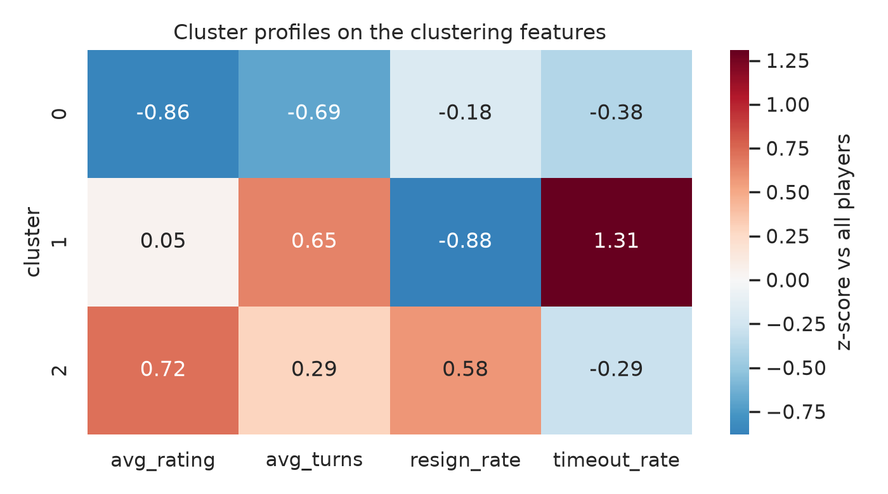
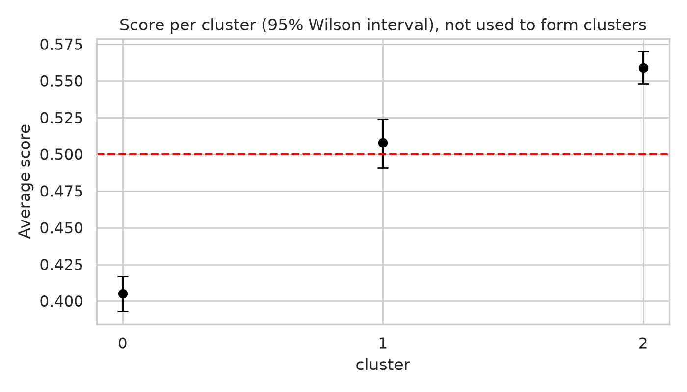
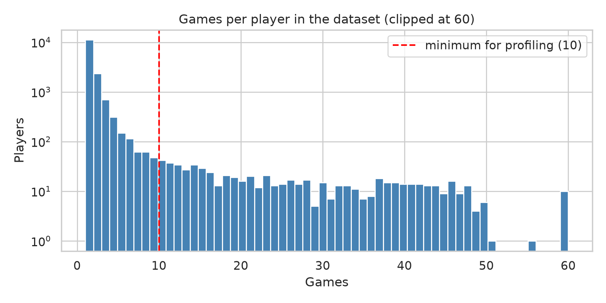
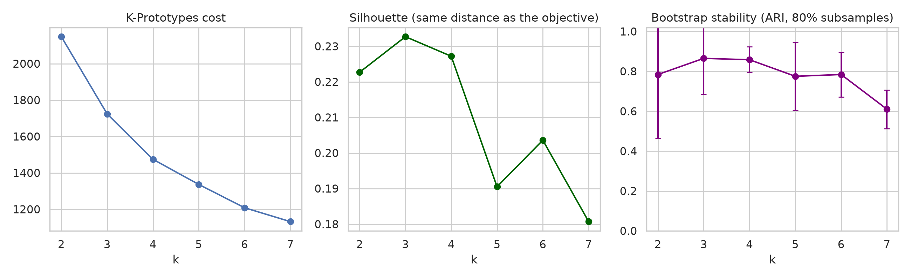
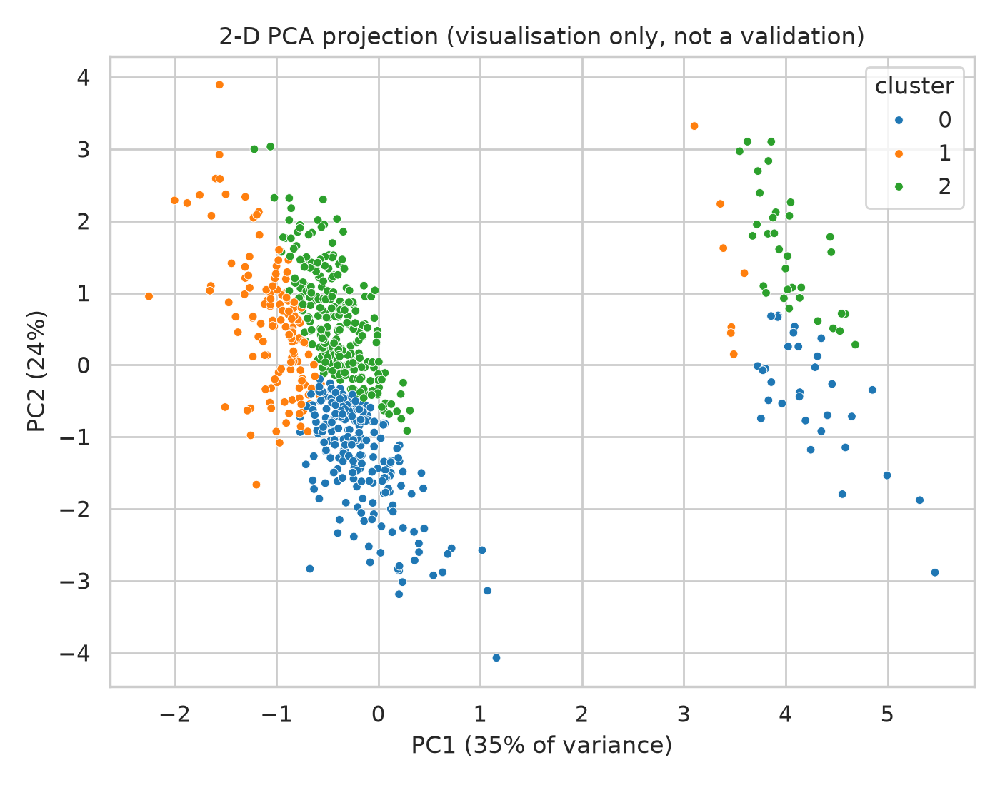

# Chess Player Segmentation: what separates Lichess players, and what clustering cannot tell you

Unsupervised segmentation of 688 Lichess players (those with at least 10 games in a public dataset) using mixed-type K-Prototypes, followed by validation and a small demo app. The main lesson: the segments that emerge are mostly **rating tiers**, the cluster structure is **weak**, and several tempting conclusions (win-rate "styles", opening "recipes") do not survive a careful check.

## Key results

* **3 segments**, chosen with a rule fixed in advance: among k = 3 to 6 whose bootstrap stability (ARI) is at least 0.8, take the best silhouette.
* **The structure is weak.** Silhouette is 0.23 (values below about 0.25 indicate little separation). Refitting on random 80% subsamples and assigning everyone gives ARI 0.828 ± 0.211 (minimum 0.401, 20 runs), so the segments are a coarse description, not natural categories.
* **Segments differ mostly in rating and in how games end** (table below). Segment 1 is distinct for long games that often end on time.
* **Segments differ in score but not in over- or under-performance.** Higher-rated segments score more, yet each segment's score is within about 0.01 of what Elo ratings predict, as expected for a rating system.
* **Favourite opening is associated with segment** (chi-square p = 1.1e-10, 16 d.o.f.; opening was *not* a clustering input). The strongest association: "King's Pawn Game" has lift 2.0 in segment 0. This is descriptive: opening choice moves together with rating.
* Results are stable to the minimum-games threshold only up to a point (ARI 0.938 at 5 games and 0.797 at 20 games versus the reference).

### Segments

| segment | players | share | avg rating | avg plies | resign rate | timeout rate | description |
|---|---|---|---|---|---|---|---|
| 0 | 255 | 37% | 1326 | 50.3 | 0.52 | 0.05 | lower rated, shorter games (mostly rapid) |
| 1 | 139 | 20% | 1605 | 69.9 | 0.38 | 0.19 | longer games, games rarely end by resignation, many games lost on time (mostly rapid) |
| 2 | 294 | 43% | 1812 | 64.7 | 0.66 | 0.06 | higher rated, games often end by resignation (mostly rapid) |

Descriptions are generated automatically from z-scores of the clustering features. They describe the data and carry no psychological meaning. Segment ids are sorted by mean rating.

### Outcomes (computed afterwards, not used to form segments)

| segment | games | score | 95% interval | score minus Elo-expected |
|---|---|---|---|---|
| 0 | 6806 | 0.405 | 0.393 to 0.417 | 0.0 |
| 1 | 3431 | 0.508 | 0.491 to 0.524 | 0.004 |
| 2 | 7915 | 0.559 | 0.548 to 0.570 | -0.0 |




## Data

Kaggle "Chess Game Dataset (Lichess)", 20,058 games between 2013-08-17 and 2017-09-04, 15,635 distinct players. Not redistributed; see [`data/README.md`](data/README.md).

* 19.5% of games are casual and 4.7% are draws (a draw scores 0.5).
* Only 688 of 15,635 players have at least 10 games, so most of the dataset is not usable for player-level profiling.



## Method

1. **Player profiles** (`src/features.py`): per player, mean rating, mean game length (plies), resign rate, timeout rate and preferred speed class (bullet/blitz/rapid/classical from the time control). Win rate, score over Elo expectation and favourite opening are also computed, but only used to describe segments.
2. **Segmentation** (`src/clustering.py`): numeric features standardised; K-Prototypes (Huang initialisation, 5 restarts, fixed seed); ids renumbered by mean rating so they are reproducible across library versions.
3. **Choosing k and validating** (`src/evaluation.py`): cost, silhouette computed with the same distance as the K-Prototypes objective, and bootstrap stability (fit on 80% of players, assign all, compare with the reference partition).
4. **Post-hoc description**: score per segment with Wilson intervals, score minus Elo-expected score, and opening lift per segment.

| k | cost | silhouette | ari_mean | ari_std |
|---|---|---|---|---|
| 2.0 | 2148.38 | 0.2227 | 0.784 | 0.32 |
| 3.0 | 1723.74 | 0.2327 | 0.865 | 0.18 |
| 4.0 | 1474.27 | 0.2272 | 0.858 | 0.065 |
| 5.0 | 1336.48 | 0.1905 | 0.775 | 0.171 |
| 6.0 | 1208.17 | 0.2036 | 0.784 | 0.112 |
| 7.0 | 1132.01 | 0.1807 | 0.61 | 0.097 |




## Design decisions

* **Outcomes are not inputs.** Win rate from a handful of games is very noisy, and clustering on it just cuts a noisy variable into bins. It is reported after the fact with intervals.
* **`opening_ply` is excluded.** For 96.6% of opening names it has a single value, so it measures the opening, not the player.
* **No association-rule mining.** Mining rules between a cluster and variables derived from the same inputs is circular. Opening association is instead measured against an opening variable that was never used for clustering.
* **Minimum 10 games per player**, a compromise between sample size and noisy per-player rates.

## Limitations

* Small sample, 2013 to 2017, one platform; casual and rated games are mixed.
* Per-player rates still rest on few games; segment membership of an individual is uncertain.
* K-Prototypes assumes roughly spherical groups and depends on the relative weight of numeric and categorical parts (kmodes default `gamma`).
* Segment descriptions are summaries, not explanations. Nothing here supports giving training advice to an individual.

## Demo

The demo needs a personal Lichess API token: the game-export endpoint requires OAuth2 and returns `404` for anonymous requests (even when the user exists). Create a token at <https://lichess.org/account/oauth/token/create> (no scopes are needed to read public games), then:

```bash
export LICHESS_TOKEN="lip_..."
streamlit run app/streamlit_app.py
```

Alternatively, copy `.streamlit/secrets.toml.example` to `.streamlit/secrets.toml` and fill in your token. That file is git-ignored; never commit a real token.

Enter a Lichess username; the app downloads recent rated games through the Lichess API (`src/lichess.py`), builds the same profile and shows the closest segment, how the player compares with its average, and that segment's training-sample outcomes. The API client is covered by unit tests with mocked responses. For a public deployment use Streamlit Community Cloud or Hugging Face Spaces (the trained model is only a few kB and is committed) and add `LICHESS_TOKEN` to the deployment's secrets or environment variables.

The token is only needed for the demo: `run_pipeline.py` and `pytest` do not use the API.

## Reproduce

```bash
python -m venv .venv && source .venv/bin/activate   # Windows: .venv\Scripts\activate
pip install -r requirements.txt
# download games.csv into data/ (see data/README.md)
python run_pipeline.py      # or: --stage select, then --stage fit
pytest -q
```

The saved model is a pickle tied to the pinned scikit-learn version; re-run the pipeline if you use another version. The pipeline and tests do not need a Lichess token; only the demo does (see [Demo](#demo)).

## Structure

```
run_pipeline.py        audit -> k selection -> final model -> validation -> results/ and models/
src/features.py        player profiles
src/clustering.py      segmenter and cluster descriptions
src/evaluation.py      silhouette, bootstrap stability, outcomes, opening association
src/lichess.py         API client and parser
src/plots.py           figures
app/streamlit_app.py   demo
tests/                 unit tests (25)
```

License: MIT.
